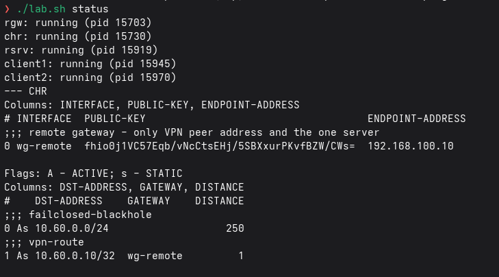
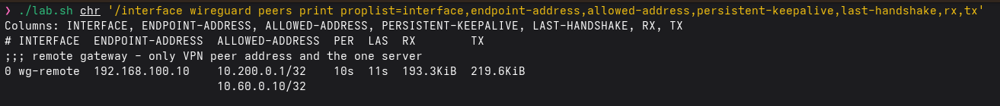
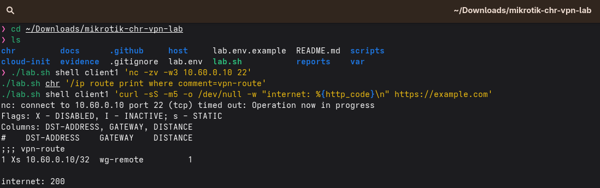
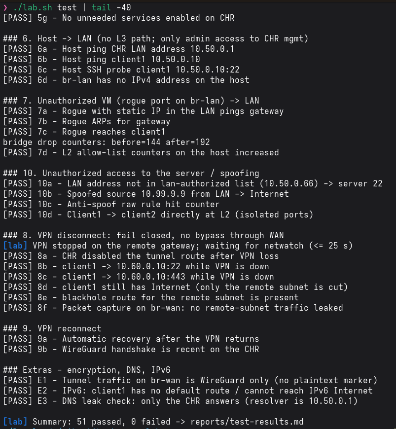

# MikroTik CHR in QEMU: isolated LAN + WireGuard to a remote server

A MikroTik CHR runs in QEMU/KVM and protects an isolated LAN (`10.50.0.0/24`). The LAN can reach one server (`10.60.0.10`, SSH and HTTPS) in a remote network (`10.60.0.0/24`), and only through a WireGuard tunnel. The firewall denies everything by default, and if the VPN drops the clients lose access to the remote network instead of falling back to the normal route.

Until I have a real server, the remote side is two more VMs (a gateway and the server). Switching to a real one is one setting, see [docs/deploy-on-server.md](docs/deploy-on-server.md).

## How it works

The animation plays four cases: a client using the server, a client trying things it shouldn't, the VPN going down, and intruders.


There is also a [clickable version](https://12viskas12.github.io/mikrotik-chr-secure-vpn/) (`docs/index.html`).

## My run

I ran the whole thing on my PC (Arch, QEMU/KVM, CHR 7.12.1) and all 51 checks passed. The steps with every command are in [docs/my-run.md](docs/my-run.md).

| Lab is running | WireGuard peer |
|---|---|
|  |  |
| VPN down | Test summary |
|  |  |

All screenshots: [docs/screenshots.md](docs/screenshots.md).

## Architecture

```
 Internet / physical network
        |  (host NAT, nftables)
   [ br-wan  192.168.100.0/24 ]----------- rgw (remote VPN gateway, .10)
        |                                      |  WireGuard 10.200.0.1
   wan  |                                [ br-remote  10.60.0.0/24, no host IP ]
 +------+--------+   WireGuard tunnel          |
 |  MikroTik CHR |=============================+--- rsrv (server 10.60.0.10, decoy .20)
 | mgmt  lan  wg |  10.200.0.2
 +--+-----+------+
    |     |
[br-mgmt] [ br-lan 10.50.0.0/24, no host IP, MAC allow-list, isolated ports ]
172.31.0.1  client1 .10   client2 .11
(admin only)
```

| Segment | Bridge | Host IP | Who is on it |
|---|---|---|---|
| Management | `br-mgmt` | 172.31.0.1 | host (admin) + CHR `mgmt` only |
| WAN / "Internet" | `br-wan` | 192.168.100.1 (NAT to uplink) | CHR `wan`, remote gateway |
| LAN | `br-lan` | **none** | CHR `lan`, client1, client2 |
| Remote site | `br-remote` | **none** | remote gateway, server |

Details: [docs/architecture.md](docs/architecture.md) · [docs/qemu-config.md](docs/qemu-config.md) · [docs/firewall.md](docs/firewall.md)

## Quick start (Arch Linux; Debian/Ubuntu also supported)

```bash
git clone https://github.com/12Viskas12/mikrotik-chr-secure-vpn && cd mikrotik-chr-secure-vpn
cp lab.env.example lab.env && $EDITOR lab.env   # set ADMIN_PASSWORD (letters+digits)
./lab.sh deps        # installs qemu, nftables, dnsmasq, wireguard-tools, ...
sudo usermod -aG kvm "$USER"                      # once, then log out/in
./lab.sh up          # keys, images, bridges, VMs, VPN (first run: ~10 min, downloads images)
./lab.sh test        # 10 required checks + extras -> reports/test-results.md
./lab.sh backup      # sanitised CHR export -> docs/chr-export.rsc
./lab.sh down        # remove everything from the host
```

The same steps with screenshots: [docs/my-run.md](docs/my-run.md).

WinBox/SSH to the CHR from the host: `ssh admin@172.31.0.2` (only the host address `172.31.0.1` is accepted).

## What is implemented (mapped to the task)

| Task stage | Implementation |
|---|---|
| I. QEMU + CHR | `scripts/fetch-images.sh`, `scripts/vms.sh`: CHR 2 vCPU, 1 GB RAM, 2 GB disk, SeaBIOS, virtio NICs; WinBox/SSH only from `172.31.0.1` |
| II. WAN | static WAN IP, default route, masquerade; raw/forward rules block WAN to LAN; host forwards only `br-wan` to uplink with WAN-range sources |
| III. Isolated LAN | `br-lan` without host IP, nftables **bridge** MAC/port allow-list, isolated client ports, ARP `reply-only`, DHCP static leases |
| IV. VPN | WireGuard + pre-shared key, `persistent-keepalive`, peer `allowed-address` = peer + one server only |
| V. Server access | only `src lan-authorized -> 10.60.0.10 tcp/22,443 (+ping)`; 3389 and rest of `10.60.0.0/24` denied; WAN to remote denied |
| VI. Policy | default deny on input/forward, anti-spoofing (raw), services off, DHCP on LAN only, firewall logging to disk, **fail closed** (blackhole route + out-interface rule + netwatch) |
| VII. Tests | `scripts/run-tests.sh`: ping, nmap, traceroute, tcpdump leak capture, rogue VM, VPN down/up |
| Bonus | separate mgmt segment, admin/read-only users, MAC/IP pinning, netwatch VPN monitor, auto route disable, daily config export + `backup`, DNS-leak and IPv6 checks, drop logging |

## Repository layout

| Path | Content |
|---|---|
| `lab.sh` | single entry point (`up`, `down`, `test`, `backup`, ...) |
| `host/` | host nftables (NAT, forward policy, **L2 bridge filter**) and dnsmasq templates |
| `chr/chr-lab.rsc.tpl` | full RouterOS configuration template |
| `cloud-init/` | remote gateway, server, clients |
| `scripts/` | automation, tests, sanitiser, real-server helper |
| `docs/` | my-run walkthrough, architecture, firewall table, testing, security findings, deployment |
| `reports/` | final report and generated `test-results.md` |
| `evidence/` | `screenshots/`, `sanitized-logs/` |

## Evidence

Walkthrough of my run: [docs/my-run.md](docs/my-run.md) · screenshots: [docs/screenshots.md](docs/screenshots.md) · tests: [docs/testing.md](docs/testing.md), [reports/test-results.md](reports/test-results.md) · report: [reports/final-report.md](reports/final-report.md).

## Repository security

Never commit `lab.env`, `var/`, keys, disk images. `.gitignore`, `scripts/pre-push-check.sh` and CI (gitleaks) enforce this; evidence passes through `scripts/sanitize.sh`.

## Limits

CHR runs on the free licence (1 Mbit/s per interface), enough for the lab. The RouterOS script targets RouterOS 7.x; syntax of the first import should be confirmed on your CHR version (see [docs/testing.md](docs/testing.md)).
