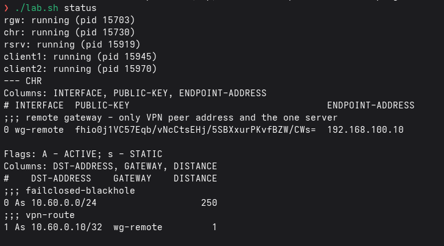
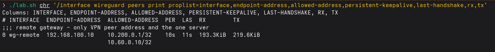
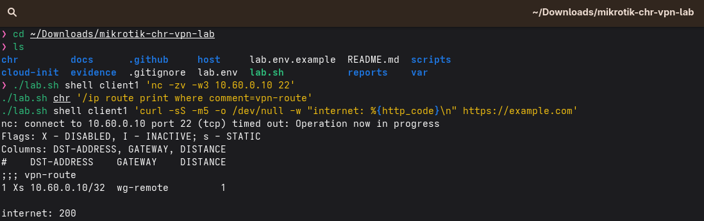
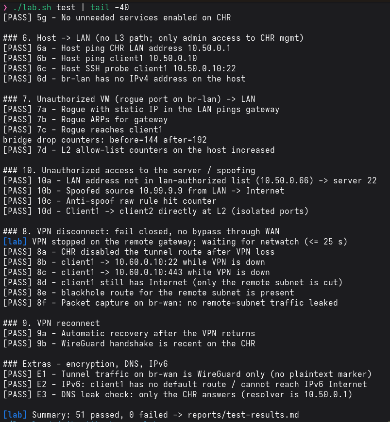

# MikroTik CHR in QEMU: isolated LAN and WireGuard VPN

This is my solution to the task "Deploying MikroTik CHR in QEMU with an isolated network segment and VPN". A CHR virtual router sits between a small LAN (`10.50.0.0/24`) and the internet. The LAN can reach one server, `10.60.0.10`, on ports 22 and 443, and only through a WireGuard tunnel. If the tunnel goes down, access to that network stops. Nothing falls back to the normal route.

I don't have the real server yet, so the remote side is simulated with two more VMs, a gateway and the server. To use a real one, change `WG_ENDPOINT_HOST` in `lab.env`, see [docs/deploy-on-server.md](docs/deploy-on-server.md).

## Scheme

The animation goes through four cases: a client using the server, a client trying things it shouldn't, the VPN going down, and an intruder. There is also a [clickable version](https://12viskas12.github.io/mikrotik-chr-secure-vpn/), the same page as `docs/index.html`.


## Network

```
 Internet / physical network
        |  (host NAT, nftables)
   [ br-wan  192.168.100.0/24 ]----------- rgw (remote VPN gateway, .10)
        |                                      |  WireGuard 10.200.0.1
   wan  |                                [ br-remote  10.60.0.0/24, no host IP ]
 +------+--------+   WireGuard tunnel          |
 |  MikroTik CHR |=============================+--- rsrv (server 10.60.0.10, decoy .20)
 | mgmt  lan  wg |  10.200.0.2
 +--+-----+------+
    |     |
[br-mgmt] [ br-lan 10.50.0.0/24, no host IP, MAC allow-list, isolated ports ]
172.31.0.1  client1 .10   client2 .11
(admin only)
```

There are four Linux bridges. Only `br-mgmt` and `br-wan` have an address on the host. The host has no IP on `br-lan` and `br-remote`, so it can't reach those networks at all.

| Bridge | Host IP | Connected |
|---|---|---|
| `br-mgmt` | 172.31.0.1 | host and the CHR management port |
| `br-wan` | 192.168.100.1 | CHR WAN port, remote gateway; NAT to the real uplink |
| `br-lan` | none | CHR LAN port, client1, client2 |
| `br-remote` | none | remote gateway, server, decoy |

More in [docs/architecture.md](docs/architecture.md), [docs/qemu-config.md](docs/qemu-config.md) and [docs/firewall.md](docs/firewall.md).

## Running it

You need a Linux machine with KVM. I used Arch. `./lab.sh deps` also knows apt, but I haven't tried Debian or Ubuntu.

```bash
git clone https://github.com/12Viskas12/mikrotik-chr-secure-vpn
cd mikrotik-chr-secure-vpn
cp lab.env.example lab.env      # set ADMIN_PASSWORD, letters and digits only
./lab.sh deps
sudo usermod -aG kvm "$USER"    # once, then log out and in
./lab.sh up                     # the first run downloads images, about 10 minutes
./lab.sh test
./lab.sh backup
./lab.sh down
```

`backup` saves a copy of the CHR config without secrets to `docs/chr-export.rsc`. To log in to the CHR from the host: `ssh admin@172.31.0.2`. It only accepts the host address 172.31.0.1.

## My run

I ran everything on my PC (Arch, QEMU/KVM, CHR 7.12.1) and 51 checks passed. The commands step by step are in [docs/my-run.md](docs/my-run.md).

| Lab is running | WireGuard peer |
|---|---|
|  |  |
| VPN down | Test summary |
|  |  |

The rest of the screenshots are in [docs/screenshots.md](docs/screenshots.md), the test table is in [reports/test-results.md](reports/test-results.md), and the short report is [reports/final-report.md](reports/final-report.md).

## What is where

- `lab.sh` runs everything (`up`, `down`, `test`, `backup` and so on)
- `chr/chr-lab.rsc.tpl` is the RouterOS config
- `host/` has the host firewall (nftables) and dnsmasq templates
- `cloud-init/` has the setup for the remote gateway, the server and the clients
- `scripts/` has the automation and the tests
- `docs/` has the documentation, `evidence/` the screenshots and logs

## Notes

- The free CHR licence limits every interface to 1 Mbit/s. That is enough here.
- The RouterOS config was written for 7.x and tested on 7.12.1. On a newer version the import may stop on a changed command, usually netwatch or the blackhole route. The error shows the line.
- `lab.env`, `var/` and the keys are in `.gitignore`. Before a push I run `scripts/pre-push-check.sh`.
