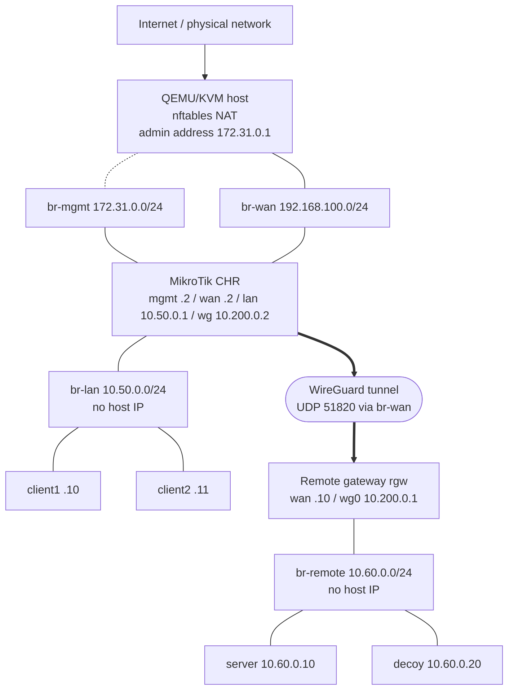
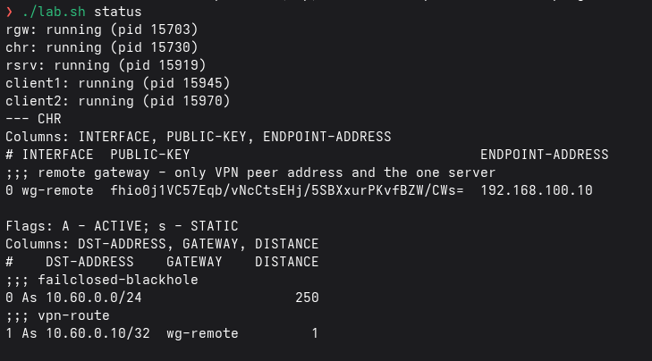
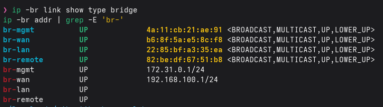
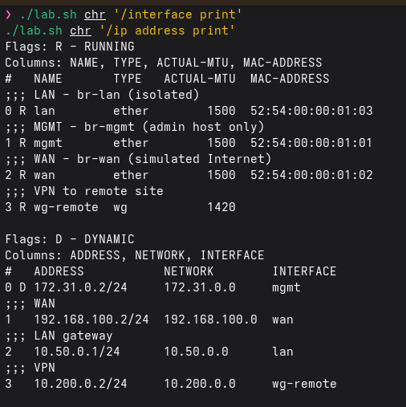
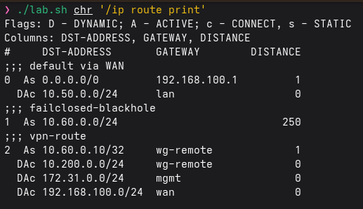

# Architecture

## Scheme

## Addressing

| Node | Interface | Address | MAC |
|---|---|---|---|
| Host | br-mgmt | 172.31.0.1/24 | - |
| Host | br-wan | 192.168.100.1/24 | - |
| CHR | mgmt (ether1) | 172.31.0.2 (static DHCP lease) | 52:54:00:00:01:01 |
| CHR | wan (ether2) | 192.168.100.2/24 | 52:54:00:00:01:02 |
| CHR | lan (ether3) | 10.50.0.1/24 | 52:54:00:00:01:03 |
| CHR | wg-remote | 10.200.0.2/24 | - |
| client1 / client2 | lan | 10.50.0.10 / .11 (DHCP reservation) | 52:54:00:00:04:01 / :02 |
| DHCP pool | lan | 10.50.0.100-200 | - |
| Remote gateway | wan / remote / wg0 | 192.168.100.10 / 10.60.0.1 / 10.200.0.1 | 52:54:00:00:02:01 / :02 |
| Server | remote | 10.60.0.10 (+ decoy 10.60.0.20) | 52:54:00:00:03:01 |

## How the isolation works

The host has no IP address on `br-lan` and `br-remote` and IPv6 is switched off there, so it can't talk to those networks. It also forwards only one thing, traffic from `br-wan` to the uplink with a source address from the WAN range. Everything else going through a lab bridge is dropped, so the host can't be used to get around the CHR.

On top of that there is an nftables filter in the bridge family. Frames coming into `br-lan` from any port except the CHR LAN port and the two client ports are dropped, and each port is pinned to its MAC address. A foreign VM plugged into `br-lan` can neither send nor receive anything. The client ports are also marked isolated, so client1 and client2 only talk to the CHR.

The CHR adds its own checks: ARP `reply-only`, static DHCP leases, anti-spoofing rules in raw and default deny.

## Fail closed

The route to `10.60.0.10/32` through `wg-remote` is enabled only while netwatch sees the peer answer. A blackhole route for `10.60.0.0/24` with distance 250 covers the rest. When the VPN is down, packets for that network are thrown away instead of following the default route. Two more rules drop traffic to the remote network that would leave through an interface outside the `VPN` list, one in forward and one in output.

## Screenshots from my run

Steps: [my-run.md](my-run.md).
