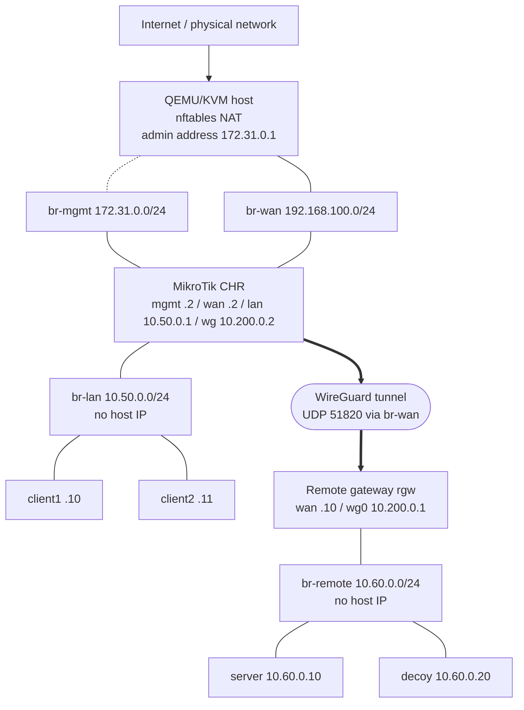
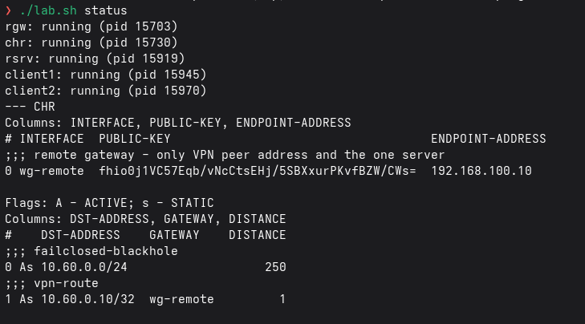
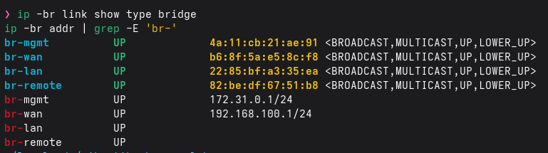
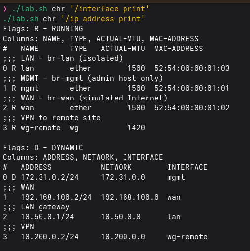
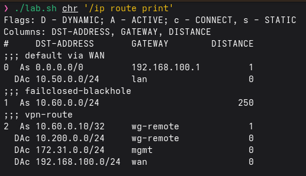

# Architecture and addressing

## Logical scheme

## Addressing

| Node | Interface | Address | MAC |
|---|---|---|---|
| Host | br-mgmt | 172.31.0.1/24 | - |
| Host | br-wan | 192.168.100.1/24 | - |
| CHR | mgmt (ether1) | 172.31.0.2 (static DHCP lease) | 52:54:00:00:01:01 |
| CHR | wan (ether2) | 192.168.100.2/24 | 52:54:00:00:01:02 |
| CHR | lan (ether3) | 10.50.0.1/24 | 52:54:00:00:01:03 |
| CHR | wg-remote | 10.200.0.2/24 | - |
| client1 / client2 | lan | 10.50.0.10 / .11 (DHCP reservation) | 52:54:00:00:04:01 / :02 |
| DHCP pool | lan | 10.50.0.100-200 | - |
| Remote gateway | wan / remote / wg0 | 192.168.100.10 / 10.60.0.1 / 10.200.0.1 | 52:54:00:00:02:01 / :02 |
| Server | remote | 10.60.0.10 (+ decoy 10.60.0.20) | 52:54:00:00:03:01 |

## Why the isolation holds

1. **No L3 presence of the host** on `br-lan` / `br-remote` (no IP, IPv6 disabled) so the host cannot talk to them.
2. **Host forward policy**: only `br-wan -> uplink` with a WAN-range source; any other forward from/to a lab bridge is dropped. The host cannot be used to bypass the CHR.
3. **L2 filter (nftables bridge family)**: frames entering `br-lan` from any port other than the CHR LAN port and the two client ports are dropped, as are frames leaving to unknown ports; MAC pinning per port. A foreign VM plugged into `br-lan` is silent in both directions.
4. **Isolated bridge ports** for the clients: clients cannot talk to each other, only to the CHR.
5. **CHR**: ARP `reply-only` + DHCP static leases + raw anti-spoof rules + default deny.

## Fail closed

`10.60.0.10/32` is routed via `wg-remote` only while netwatch sees the peer; a **blackhole** `10.60.0.0/24` (distance 250) covers the rest, so with the VPN down traffic is discarded and never follows the default route. Two more rules drop remote-subnet traffic whose out-interface is not in list `VPN` (forward and output).

## Seen in the real run

All steps: [my-run.md](my-run.md).
