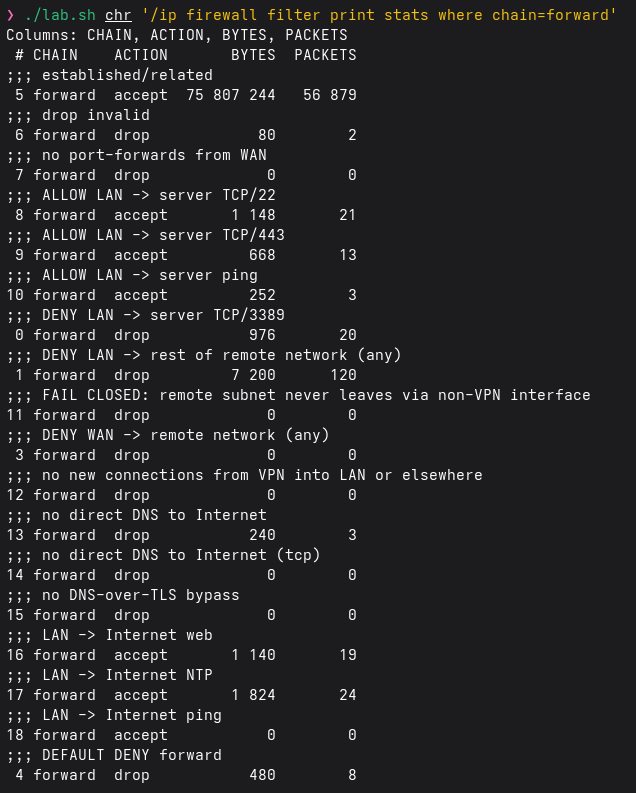
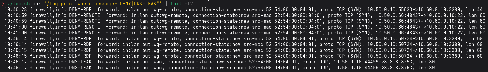
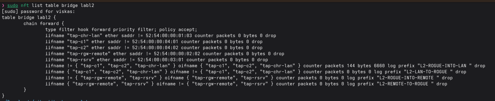

# Firewall rules on the CHR

The full export is in `docs/chr-export.rsc` (made by `./lab.sh backup`). The source is `chr/chr-lab.rsc.tpl`. Order matters, rules are checked from the top.

## Who can reach what

| Source | Destination | Port | Action | Chain |
|---|---|---|---|---|
| 10.50.0.10 and .11 | 10.60.0.10 | TCP 22 | allow | forward, out wg-remote |
| 10.50.0.10 and .11 | 10.60.0.10 | TCP 443 | allow | forward, out wg-remote |
| 10.50.0.0/24 | 10.60.0.10 | TCP 3389 | deny, log `DENY-RDP` | forward |
| 10.50.0.0/24 | 10.60.0.0/24 | any | deny, log `DENY-REMOTE` | forward |
| WAN | 10.60.0.0/24 | any | deny | raw, forward |
| WAN | 10.50.0.0/24 | any | deny | raw |

The task says the whole `10.50.0.0/24` may use the server. I allowed only the two known clients (the `lan-authorized` list), so an unknown address in the same subnet can't get in either.

## Chains

- raw prerouting: drops spoofed sources. A LAN packet must come from `10.50.0.0/24`, a management packet from the admin host, and WAN may not use LAN, remote or VPN addresses. DHCP discover is let through first. WAN traffic to the LAN and the remote network is dropped here.
- input: established allowed, invalid dropped. SSH and WinBox only from `172.31.0.1` on `mgmt`. The LAN gets DHCP, DNS and ping. WAN gets WireGuard from the known peer. Everything else is dropped and logged.
- forward: established allowed, invalid dropped, no dstnat from WAN, then the table above. LAN to the Internet is only web, NTP and ping. DNS goes only to the CHR and DoT is blocked. The end of the chain drops and logs.
- output: traffic to the remote network may leave only through `VPN` interfaces.
- NAT: one masquerade for LAN to WAN. The tunnel isn't NATed, the remote gateway routes `10.50.0.0/24` back into WireGuard.
- IPv6 is off, with default deny rules in case someone turns it on.

## Hardening

Telnet, FTP, HTTP, HTTPS and the API are disabled. SSH and WinBox accept only `172.31.0.1/32`. MAC server, neighbor discovery, bandwidth server, proxy, SOCKS, UPnP and cloud DDNS are off. SSH uses strong crypto, there is a read-only `audit` user, the firewall log goes to a file `fwlog`, and a scheduler exports the config every day.

## Screenshots from my run

Forward chain with counters:

Denials in the log:

Bridge allow-list on the host:

