# How I ran it on my PC

This is what I did to get the lab working on my own computer, in order, with the screenshots I took along the way.

Setup: Arch Linux, QEMU/KVM, MikroTik CHR 7.12.1 (free licence), Debian 12 cloud images for the rest. Done on 2026-11-03. At the end all 51 checks passed, see [test-results.md](../reports/test-results.md).

## 1. Host setup

```bash
git clone https://github.com/12Viskas12/mikrotik-chr-secure-vpn
cd mikrotik-chr-secure-vpn
./lab.sh deps
sudo usermod -aG kvm "$USER"     # then log out and back in
```

## 2. lab.env

```bash
cp lab.env.example lab.env
nano lab.env
```

I only set `ADMIN_PASSWORD` (letters and digits). The rest I left empty, the defaults work. The file is in `.gitignore`, so it never gets pushed.

## 3. Start the lab

```bash
./lab.sh up
./lab.sh status
```

The first run took a while because it downloads the CHR and Debian images. After that it generates keys, builds the bridges, starts five VMs and loads the RouterOS config into the CHR.

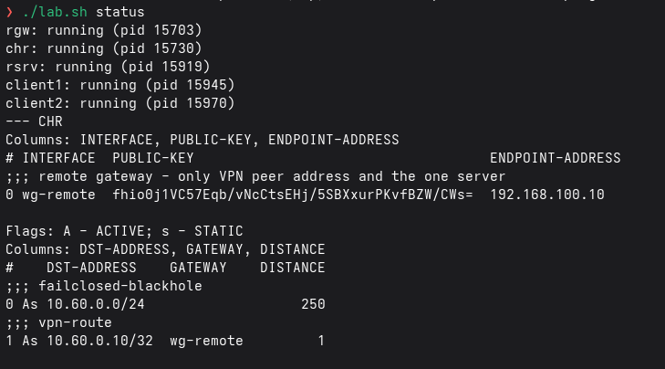

## 4. Host network

```bash
ip -br link show type bridge
ip -br addr
sudo nft list table bridge labl2
```

`br-lan` and `br-remote` have no IP on the host, which is the point.

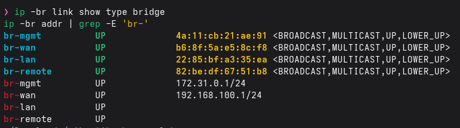

The nftables table that drops frames from unknown ports:

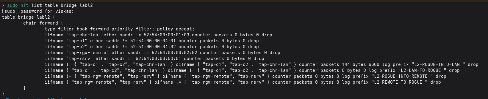

## 5. Looking at the CHR

```bash
./lab.sh chr '/interface print; /ip address print'
./lab.sh chr '/interface wireguard peers print proplist=interface,endpoint-address,allowed-address,persistent-keepalive,last-handshake,rx,tx'
./lab.sh chr '/ip route print'
```

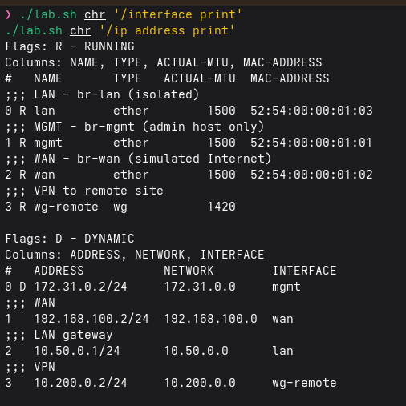

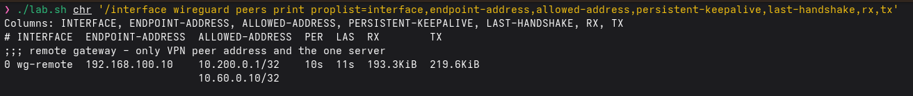

In the routing table there is the route to `10.60.0.10` through the tunnel and the blackhole for the rest of `10.60.0.0/24`.

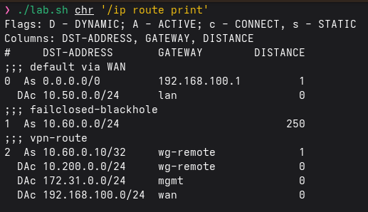

## 6. Firewall

```bash
./lab.sh chr '/ip firewall filter print stats'
```

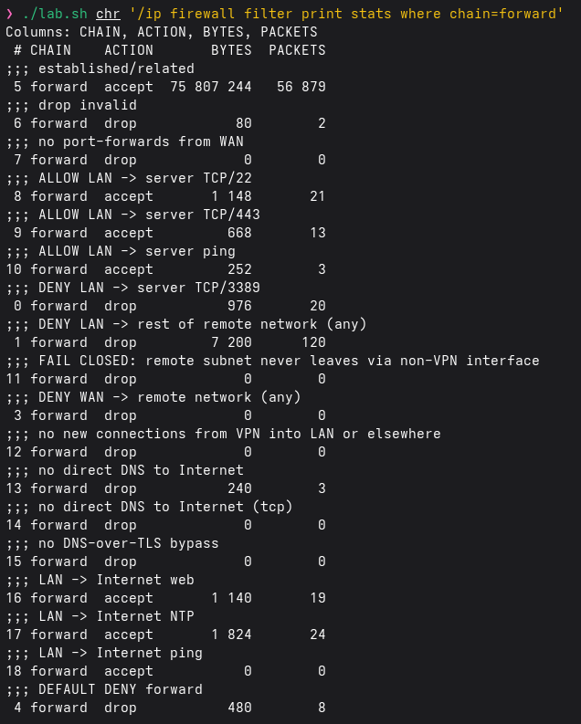

## 7. Using the VPN from a client

```bash
./lab.sh shell client1 'nmap -Pn -p 22,443,3389 10.60.0.10; traceroute -n 10.60.0.10'
./lab.sh shell client1 'nc -zv -w3 10.60.0.20 22; ping -c2 10.60.0.20'
```

22 and 443 are open, 3389 is filtered:

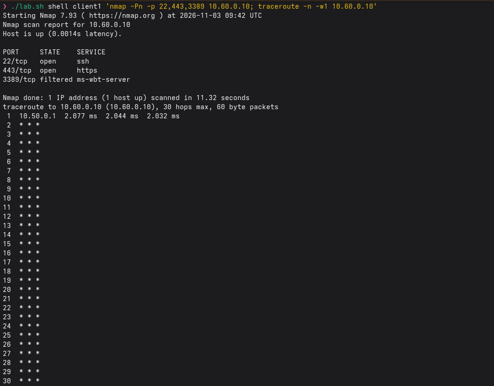

The other host in the remote network doesn't answer:

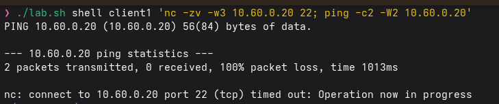

## 8. Tests

```bash
./lab.sh test
```

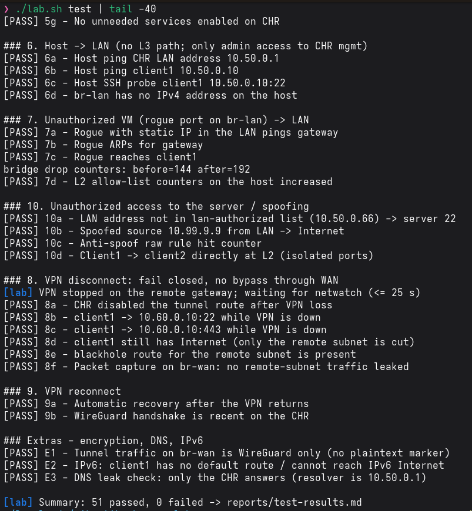

The first run was 47 passed and 4 failed. All four were my parsers: RouterOS 7.12 prints tables instead of `key=value`. After fixing them it was 51 passed, 0 failed. Full list in [test-results.md](../reports/test-results.md).

## 9. Killing the VPN

I ran these one by one, because pasting them all at once skipped the waiting and the screenshot showed nothing useful.

```bash
./lab.sh shell rgw 'systemctl stop wg-quick@wg0'
sleep 20
./lab.sh shell client1 'nc -zv -w3 10.60.0.10 22'     # fails
./lab.sh chr '/ip route print'                         # tunnel route is disabled
```

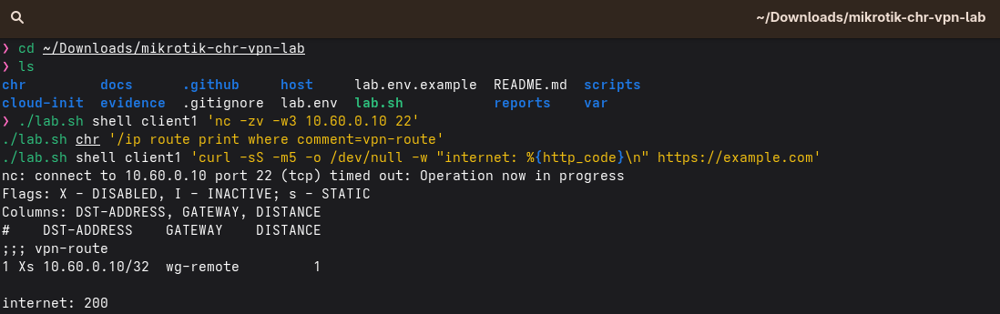

And back:

```bash
./lab.sh shell rgw 'systemctl start wg-quick@wg0'
sleep 20
./lab.sh shell client1 'nc -zv -w3 10.60.0.10 22'     # works again
```

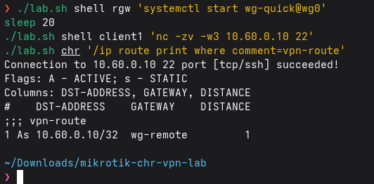

## 10. What goes over the wire

```bash
sudo tcpdump -ni br-wan udp port 51820
```

Only UDP between the CHR and the remote gateway, nothing readable.

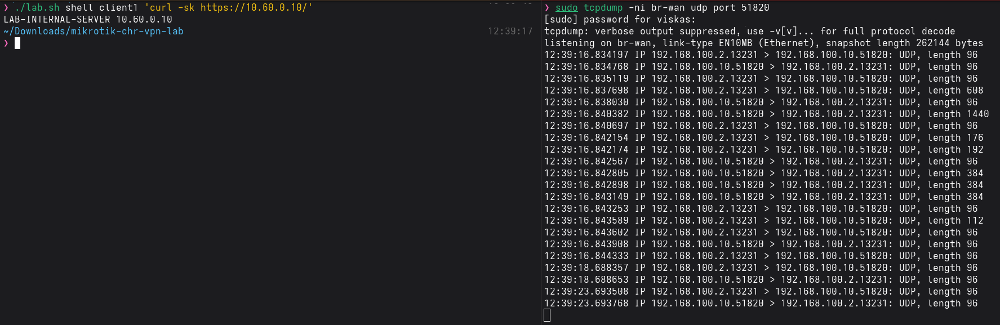

## 11. Firewall log

```bash
./lab.sh chr '/log print where message~"DENY"'
```

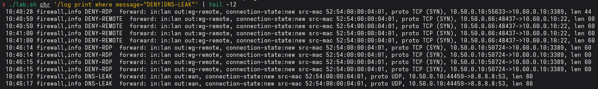

## 12. Backup and push

```bash
./lab.sh backup
bash scripts/pre-push-check.sh
git add -A && git commit -m "Lab results" && git push
```

`backup` saves [chr-export.rsc](chr-export.rsc), [chr-firewall-rules.txt](chr-firewall-rules.txt) and [chr-routing-table.txt](chr-routing-table.txt) into `docs/`. `pre-push-check.sh` looks for keys and passwords before the push.

## 13. Stopping

```bash
./lab.sh down     # VMs, bridges and host rules
./lab.sh clean    # also removes images and var/
```

## What went wrong

- 4 tests failed on the first run: the parsers expected `key=value`, RouterOS prints tables. Rewrote them.
- Debugging in zsh broke SSH: `lib.sh` is written for bash. Use `./lab.sh` or `bash -c`.
- Test 7d failed once because it counted counter lines, which don't grow. Now it compares the sum of dropped packets.
- `peers print stats` doesn't work on 7.12, so I used `print proplist=...`.
- I pasted a key fingerprint into `SSH_PUBKEY_FILE` by mistake. Left it empty, it uses the default key.

More in the [lab journal](lab-journal.md).
