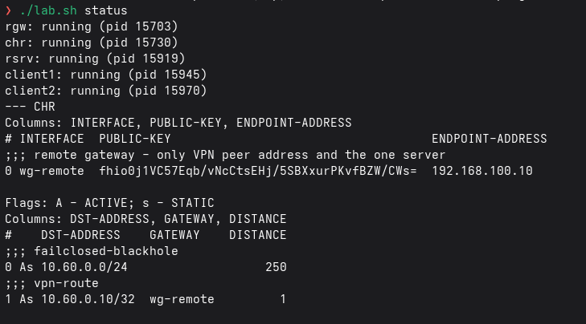
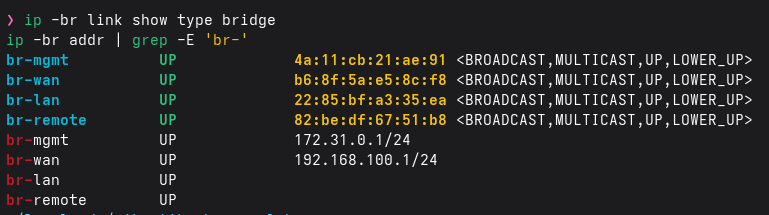

# QEMU configuration

| Parameter | Value |
|---|---|
| Hypervisor | QEMU/KVM (`-machine pc,accel=kvm -cpu host`; falls back to TCG without `/dev/kvm`) |
| Firmware | SeaBIOS (default of `pc`) |
| CHR | 2 vCPU, 1024 MB RAM, 2 GB qcow2 overlay on the official image, 3 virtio NICs |
| Debian VMs | 2 vCPU, 512 MB, 6 GB qcow2 overlays, cloud-init NoCloud seed |
| Display | none; serial console on a unix socket (`./lab.sh console chr`) |
| Guest agent | virtio-serial channel to run commands without any network path (`./lab.sh shell client1 'ip a'`) |

The CHR has a third NIC (management) in addition to the WAN and LAN required by the task, so the admin path never shares a segment with user traffic.

## Command line (generated by `scripts/vms.sh`)

```
qemu-system-x86_64 -name chr -machine pc,accel=kvm -cpu host -smp 2 -m 1024 \
  -display none -daemonize -pidfile var/run/chr.pid \
  -drive file=var/vm/chr.qcow2,format=qcow2,if=virtio \
  -serial unix:var/run/chr.console,server=on,wait=off \
  -netdev tap,id=n0,ifname=tap-chr-mgmt,script=no,downscript=no -device virtio-net-pci,netdev=n0,mac=52:54:00:00:01:01 \
  -netdev tap,id=n1,ifname=tap-chr-wan,script=no,downscript=no  -device virtio-net-pci,netdev=n1,mac=52:54:00:00:01:02 \
  -netdev tap,id=n2,ifname=tap-chr-lan,script=no,downscript=no  -device virtio-net-pci,netdev=n2,mac=52:54:00:00:01:03
```

TAP devices are pre-created by `scripts/net-up.sh`, owned by the unprivileged user, and attached to their bridge, so QEMU itself never runs as root. NIC order is irrelevant for RouterOS because interfaces are matched by MAC.

## Bridges

```
ip link add br-lan type bridge stp_state 0     # no IP, ipv6 disabled
ip tuntap add dev tap-c1 mode tap user $USER
ip link set tap-c1 master br-lan
ip link set tap-c1 type bridge_slave isolated on
```
Host rules for the bridges: `var/render/host.nft` (rendered from `host/host.nft.tpl`).

## Screenshots from my run




