# Screenshots

Taken during my run (RouterOS 7.12.1, QEMU/KVM on Arch Linux). Passwords and keys are not visible. The steps are in [my-run.md](my-run.md).

## Lab is running

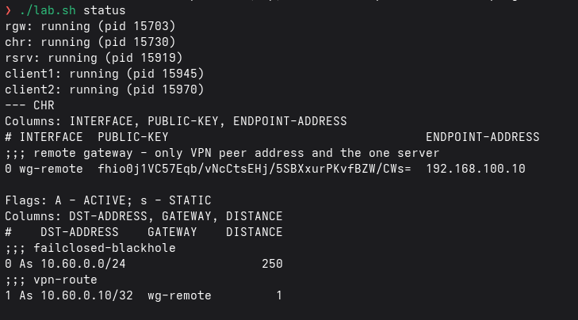

All five VMs are up: remote gateway, CHR, server and two clients. The CHR shows the WireGuard peer and two routes to the server, the tunnel route and the blackhole.

## Host bridges

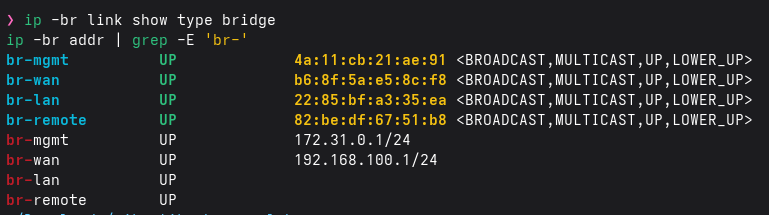

`br-mgmt` and `br-wan` have host addresses. `br-lan` and `br-remote` have no IPv4 address, so the host has no way into those networks.

## Allow-list on the host

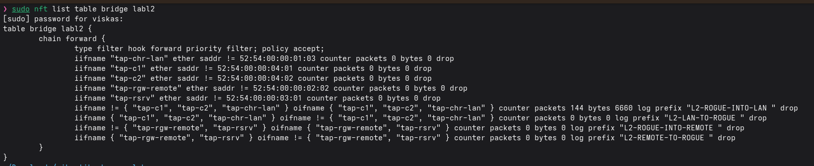

The nftables bridge table `labl2` with MAC pinning per port and the list of allowed ports for `br-lan` and `br-remote`. The counter on `L2-ROGUE-INTO-LAN` counts frames from unknown ports that were dropped.

## CHR interfaces and addresses

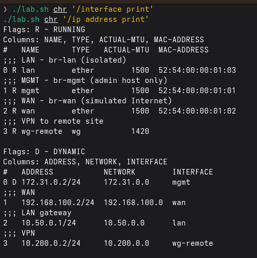

Three ethernet ports (WAN, LAN, management) and the WireGuard interface with the planned addresses: 192.168.100.2, 10.50.0.1, 172.31.0.2 and 10.200.0.2.

## WireGuard peer

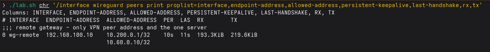

The peer may carry only `10.200.0.1/32` and `10.60.0.10/32`. Keepalive is 10 s, the handshake is recent and there is traffic both ways.

## Routing table

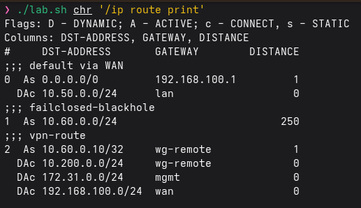

The default route through WAN, the tunnel route to `10.60.0.10/32`, and the blackhole `10.60.0.0/24` with distance 250 that makes it fail closed.

## Forward chain with counters

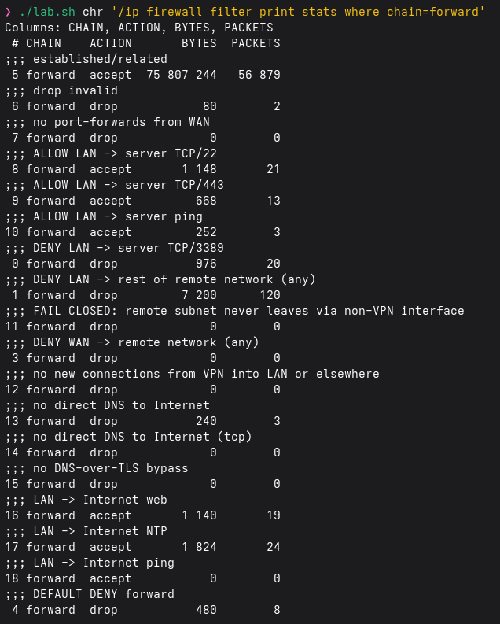

Allow rules for SSH, HTTPS and ping to the server, explicit denies for TCP 3389 and the rest of the remote network, no direct DNS, and default deny at the end. The counters show which rules were hit.

## Client to server

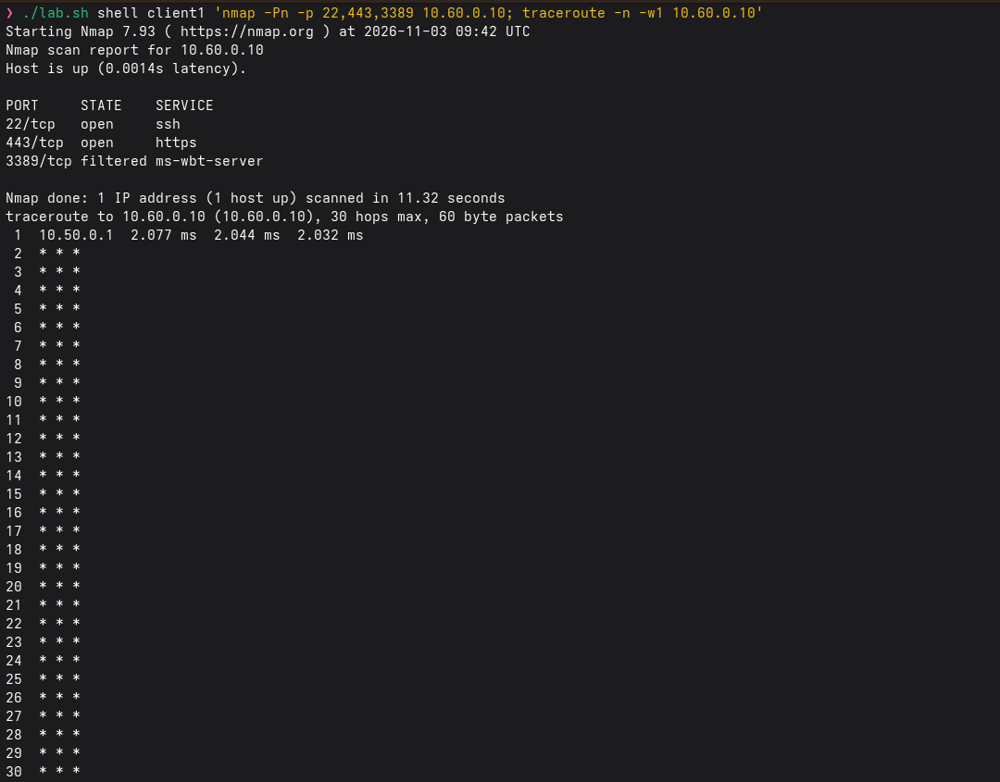

From client1, ports 22 and 443 are open and 3389 is filtered. The first hop is the CHR, 10.50.0.1.

## Other remote hosts are denied

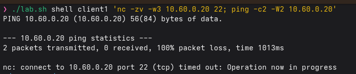

client1 can't reach 10.60.0.20. Ping gets no replies and TCP 22 times out.

## VPN down

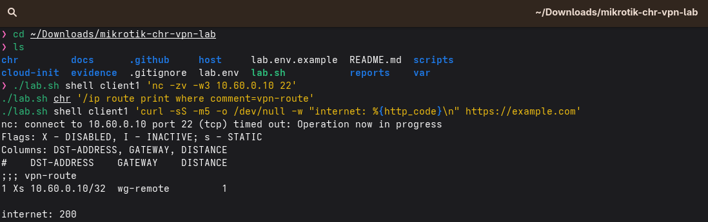

WireGuard is stopped on the remote gateway. The server is unreachable and the tunnel route is disabled (`X`), but the client still has internet. Nothing falls back to WAN.

## VPN back

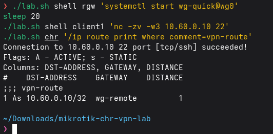

After WireGuard is started again the server answers and the tunnel route is active (`A`) again. I did nothing on the CHR.

## Only WireGuard on the wire

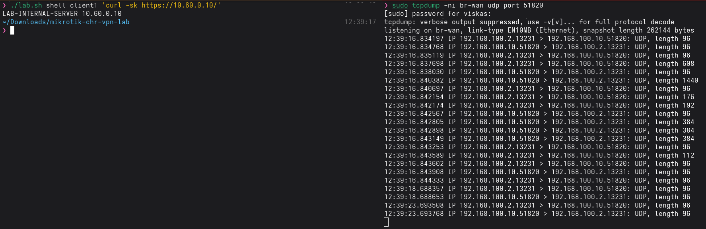

On the left client1 fetches the server page through the tunnel. On the right the capture on `br-wan` shows only UDP between 192.168.100.2:13231 and 192.168.100.10:51820.

## Test summary

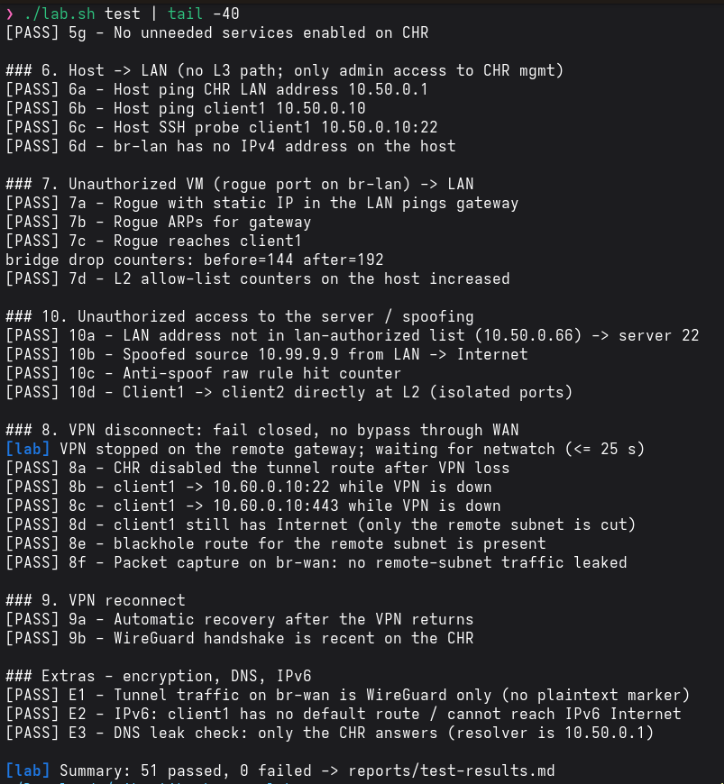

`./lab.sh test`: 51 checks passed, 0 failed. The full table is in `reports/test-results.md`.

## Firewall log

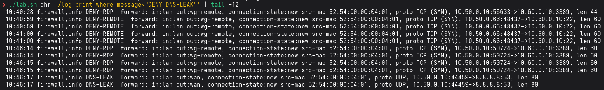

Logged denials: `DENY-RDP` (TCP 3389), `DENY-REMOTE` (an unlisted LAN address trying the server) and `DNS-LEAK` (direct DNS to 8.8.8.8).
