# Screenshots

Captured from a real run of the lab (RouterOS 7.12.1, QEMU/KVM on Arch Linux). Passwords and keys are not shown.

## Lab is running

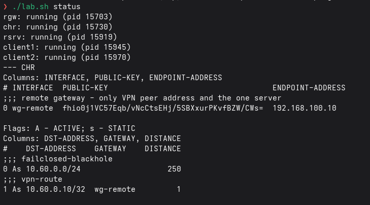

All five VMs (remote gateway, CHR, server, two clients) are up. The CHR shows the WireGuard peer and the two routes to the server: the tunnel route and the fail-closed blackhole.

## Host bridges

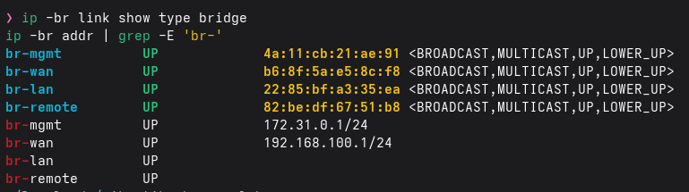

`br-mgmt` and `br-wan` have host addresses; `br-lan` and `br-remote` have **no IPv4 address**, so the host has no layer-3 path into the isolated segments.

## L2 allow-list on the host

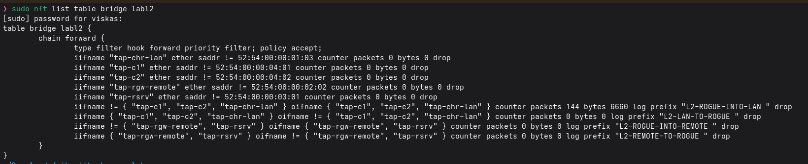

nftables bridge table `labl2`: per-port MAC pinning and a membership allow-list for `br-lan` and `br-remote`. The counter on `L2-ROGUE-INTO-LAN` shows frames from unknown ports being dropped.

## CHR interfaces and addresses

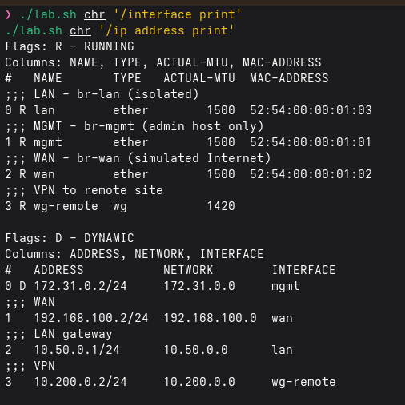

Three Ethernet ports (WAN, LAN, management) plus the WireGuard interface, addressed as in the plan: 192.168.100.2, 10.50.0.1, 172.31.0.2, 10.200.0.2.

## WireGuard peer

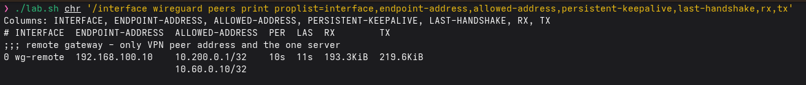

The peer is allowed to carry only the gateway address and the one server (`10.200.0.1/32`, `10.60.0.10/32`). Keepalive 10 s, a recent handshake and traffic in both directions.

## CHR routing table

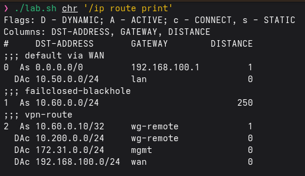

Default route via WAN, the tunnel route to `10.60.0.10/32`, and the blackhole `10.60.0.0/24` (distance 250) that implements fail closed.

## Forward chain with counters

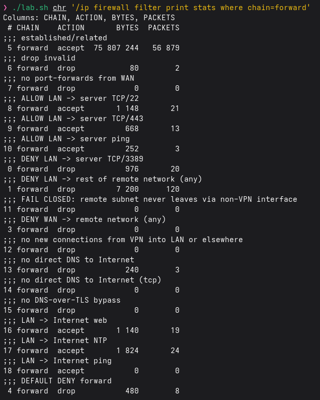

Allow rules for SSH, HTTPS and ping to the server; explicit denies for TCP/3389 and the rest of the remote network; no direct DNS; default deny. Counters show the rules in use.

## Client to server

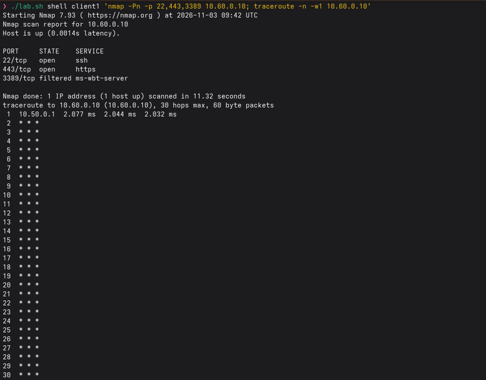

From client1: ports 22 and 443 are open, 3389 is filtered. The first hop is the CHR (10.50.0.1).

## Other remote hosts are denied

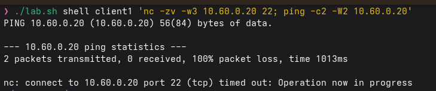

client1 cannot reach 10.60.0.20: no ping replies, TCP/22 times out.

## VPN down: fail closed

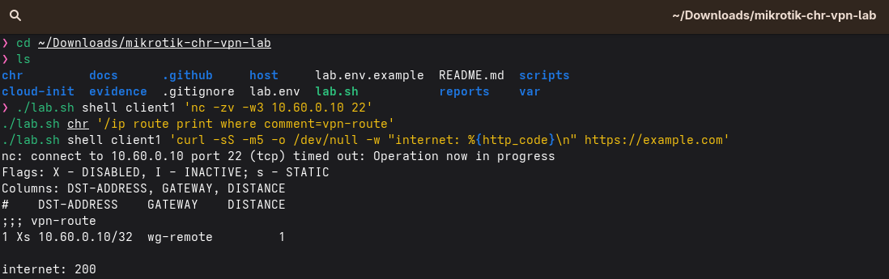

With WireGuard stopped on the remote gateway the server is unreachable, the tunnel route is disabled (`X`), and the client still has Internet access. Nothing falls back to the WAN.

## VPN back: automatic recovery

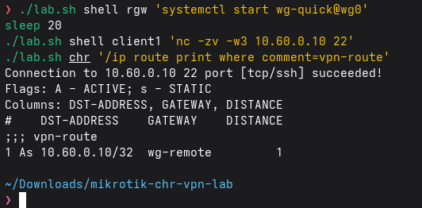

After WireGuard is started again the connection to the server succeeds and the tunnel route is active (`A`) again, with no manual steps.

## Only encrypted traffic on the wire

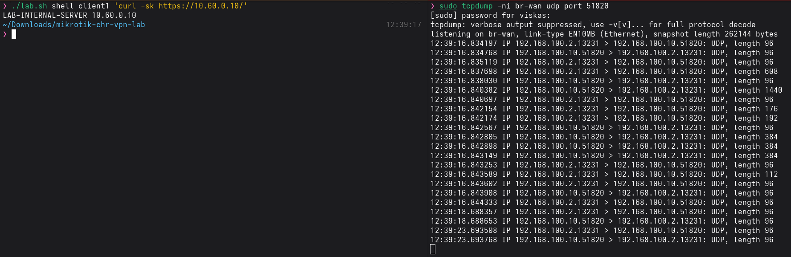

Left: client1 fetches the server page over the tunnel. Right: capture on `br-wan` shows only UDP between 192.168.100.2:13231 and 192.168.100.10:51820.

## Test summary

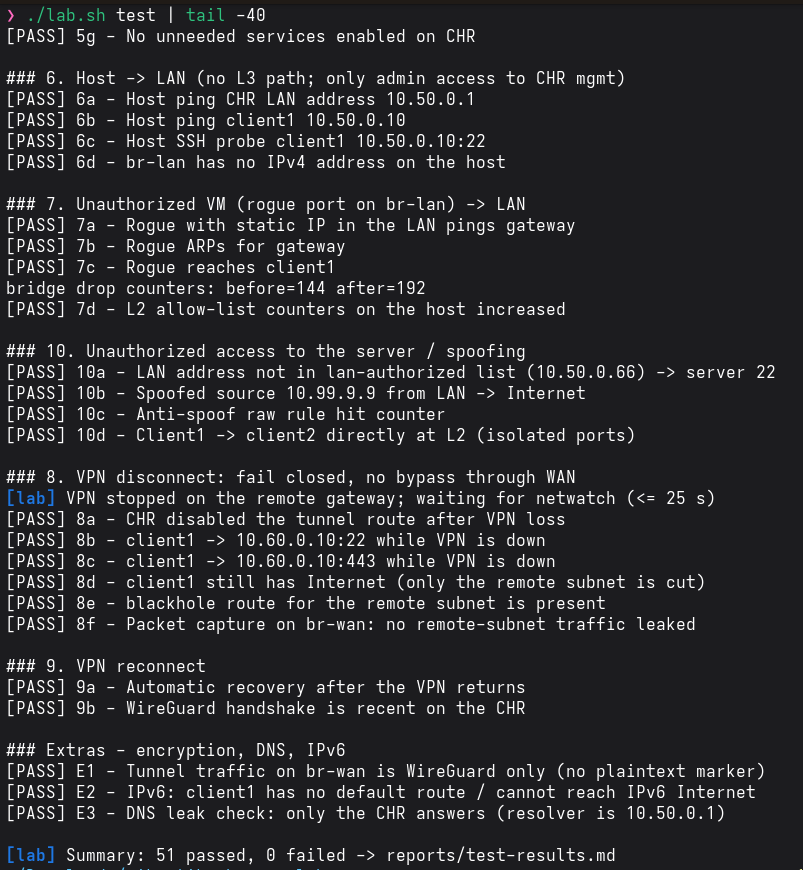

`./lab.sh test`: 51 checks passed, 0 failed (full table in `reports/test-results.md`).

## Firewall log

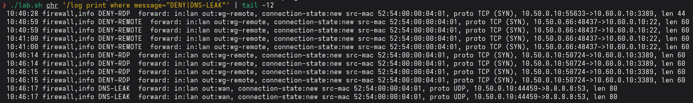

Logged denials: `DENY-RDP` (TCP/3389), `DENY-REMOTE` (an unlisted LAN address trying the server) and `DNS-LEAK` (direct DNS to 8.8.8.8).
