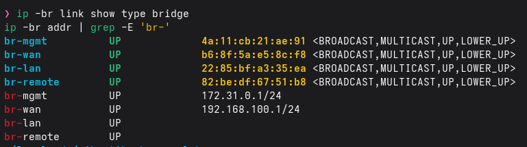
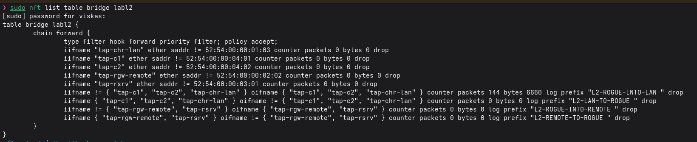
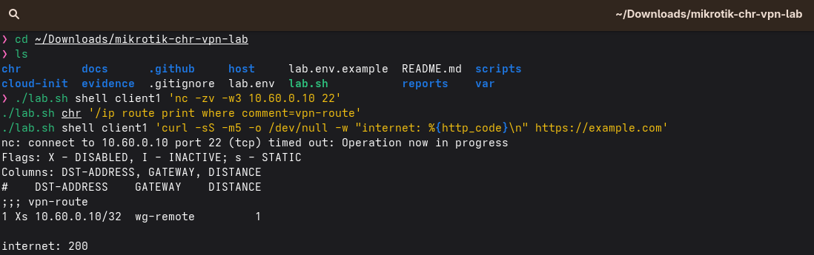
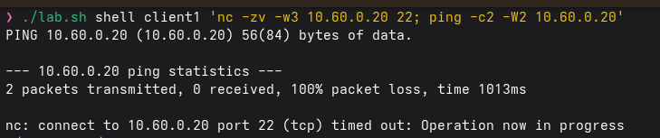
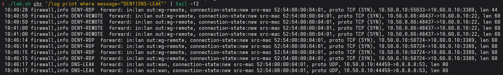
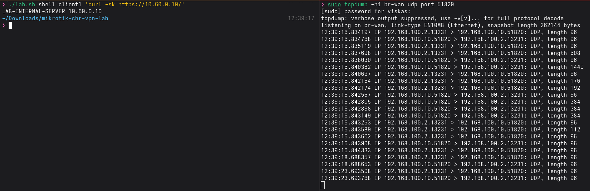

# Security findings and mitigations

Design-time findings: risks that a naive build of this task has, and what this project does about them. Confirm each against your own run in [reports/test-results.md](../reports/test-results.md).

| # | Weakness | Impact | Mitigation here |
|---|---|---|---|
| 1 | IP subnet alone does not isolate L2 | foreign VM joins the bridge, ARPs/DHCPs | nftables **bridge** allow-list + MAC pinning + isolated ports; no host IP |
| 2 | Host with IP on the LAN bridge | host becomes a path into the LAN | `br-lan` and `br-remote` have no address, IPv6 disabled, host input dropped |
| 3 | Host forwarding (`ip_forward`) lets traffic skip the CHR | CHR bypass | host forward policy only `br-wan` to uplink with WAN-range sources; restored on `down` |
| 4 | Management on WAN or LAN | admin takeover | SSH/WinBox only from `172.31.0.1` on a dedicated segment; services off; MAC-server/neighbor discovery off |
| 5 | Remote subnet falls back to the default route when the tunnel route disappears | **traffic leaves unencrypted via WAN** | blackhole route + `out-interface-list=!VPN` drop rules (forward and output) + netwatch route toggle; verified by capture on `br-wan` |
| 6 | Whole remote subnet reachable through the tunnel | lateral movement | WireGuard `allowed-address` = peer + one server; firewall allows two ports on one host; the remote gateway filters the same way (defence in depth) |
| 7 | Spoofed sources | bypass of address-based rules | raw anti-spoof rules, ARP `reply-only`, static leases, `lan-authorized` list, rp-filter |
| 8 | DNS leak / DoT bypass | client queries leave outside the policy | DNS only via CHR, direct 53 and 853 to WAN dropped |
| 9 | IPv6 side channel | IPv4 firewall bypass | IPv6 disabled on the CHR and guests, default-deny v6 rules as backup |
| 10 | Secrets in git | key/password disclosure | keys generated locally in `var/`, templates with placeholders, `.gitignore`, pre-push check, gitleaks CI, sanitiser |
| 11 | Pre-shared key and private keys on lab disks | lab-only exposure | acceptable for a lab; use a secrets manager in production |
| 12 | Free CHR licence, no config encryption at rest | n/a for lab | mention only |

## Evidence

| Finding | Screenshot |
|---|---|
| 1, 2: L2 isolation, no host IP on `br-lan` |   |
| 5: fail closed when the VPN is down |  |
| 6: only one server and two ports |  |
| 8: DNS leak blocked, denials logged |  |
| WireGuard-only traffic on the wire |  |
