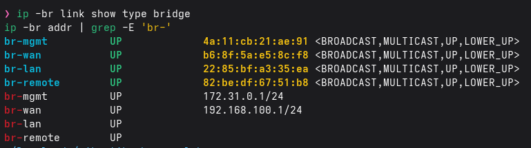
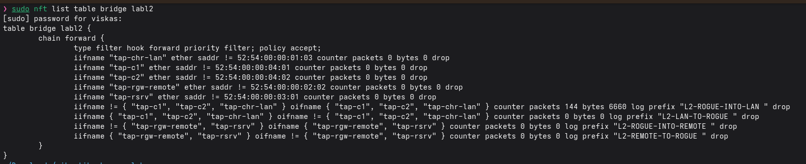
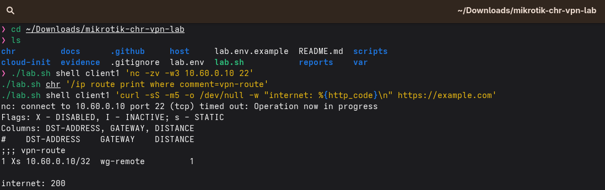
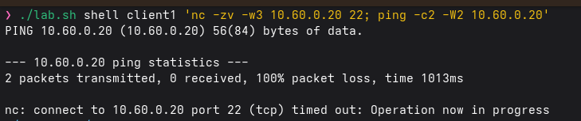
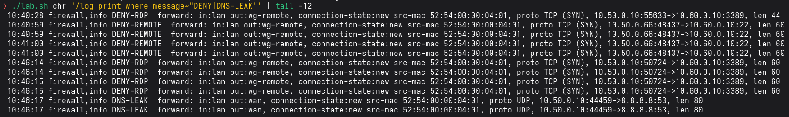
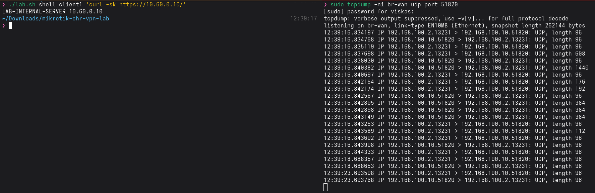

# Security notes

Problems a simple version of this task would have, and what I did about each. The results of the run are in [reports/test-results.md](../reports/test-results.md).

1. A separate IP subnet doesn't isolate anything at layer 2. A foreign VM plugged into the bridge can still send ARP and DHCP. I added the nftables bridge allow-list with MAC pinning and isolated client ports, and the host has no IP there.
2. A host address on the LAN bridge would give the host a way into the LAN. `br-lan` and `br-remote` have no address, IPv6 is off, and host input is dropped.
3. With `ip_forward` on, traffic can skip the CHR through the host. The host forwards only from `br-wan` to the uplink with a WAN-range source, and `down` restores the old setting.
4. Management on the WAN or LAN side would let anyone try to log in. SSH and WinBox are reachable only from `172.31.0.1` on their own segment, other services are off, and MAC server and neighbor discovery are disabled.
5. When the tunnel route disappears, the remote subnet can fall back to the default route and leave unencrypted through WAN. A blackhole route, drop rules on `out-interface-list=!VPN` (forward and output) and the netwatch toggle prevent that. I checked it with a capture on `br-wan`.
6. If the whole remote subnet were reachable through the tunnel, one compromised client could move sideways. WireGuard `allowed-address` is the peer plus one server, the firewall allows two ports on one host, and the remote gateway filters the same way.
7. Spoofed source addresses get around rules that match on addresses. Raw anti-spoofing rules, ARP `reply-only`, static leases, the `lan-authorized` list and rp-filter cover that.
8. DNS can leak outside the policy, and DoT bypasses it. Clients ask only the CHR, direct 53 and 853 to the WAN is dropped.
9. IPv6 could be a side channel around the IPv4 firewall. It is disabled on the CHR and the guests, with default deny rules as a backup.
10. Secrets can end up in git. Keys are generated into `var/`, templates use placeholders, and there are `.gitignore`, `scripts/pre-push-check.sh`, gitleaks in CI and a sanitiser for the evidence.
11. The pre-shared key and private keys sit on the lab disks. That's fine for a lab, in production I would use a secrets manager.

## Screenshots

Host bridges without an IP on `br-lan` (1, 2):

VPN down (5):

Only one server and two ports (6):

Denials in the log (8):

Only WireGuard on the wire:

