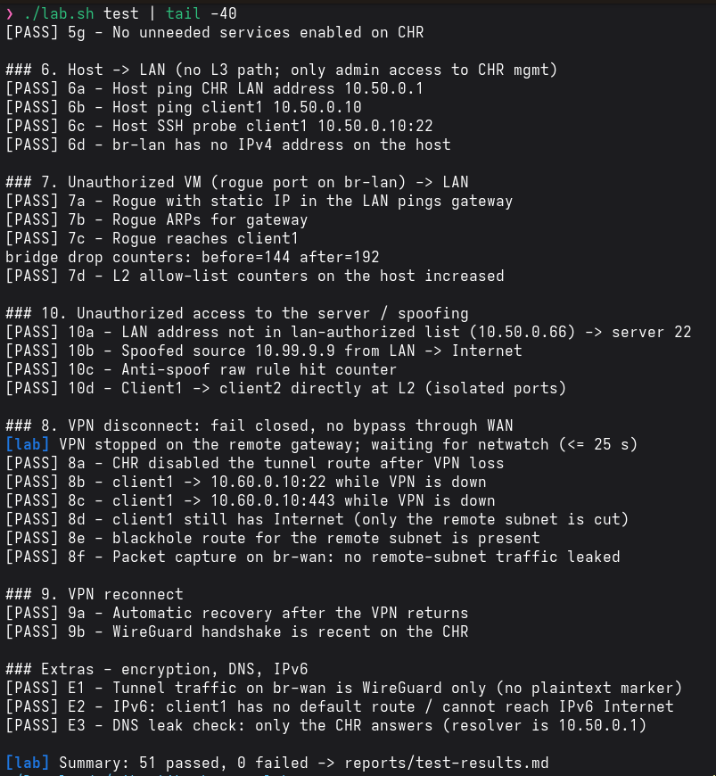
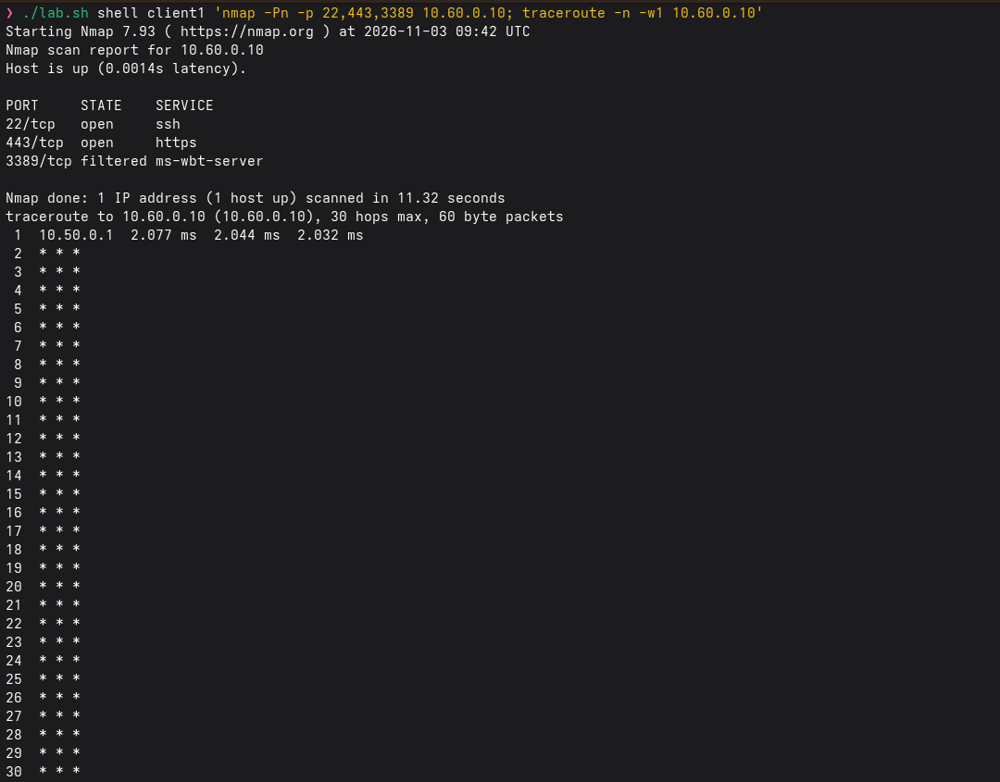
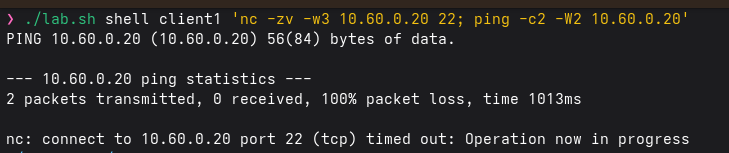
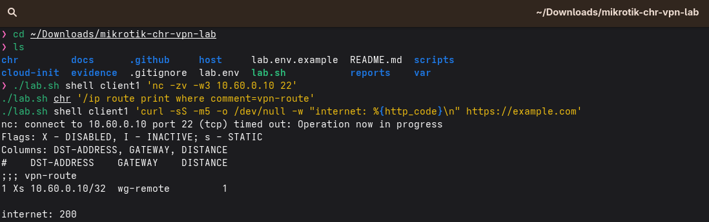
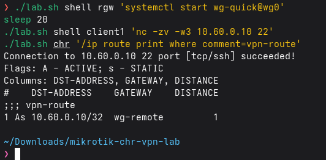
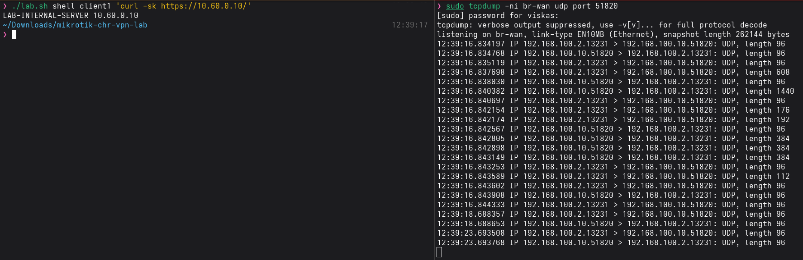

# Testing

`./lab.sh test` runs all the checks below. It writes `reports/test-results.md` and a sanitised log into `evidence/sanitized-logs/`.

| # | Check | Expected | How |
|---|---|---|---|
| 1 | LAN to Internet | web, NTP and ping work; SMTP and direct DNS are blocked | curl, nc, dig from client1 |
| 2 | LAN to server | 22, 443 and ping work | nc, curl, ping, traceroute |
| 3 | LAN to other remote hosts and ports | denied | 3389, 10.60.0.20, 10.60.0.1; nmap shows 22 and 443 open, 3389 filtered |
| 4 | WAN to LAN | denied | network namespace on `br-wan`, routes via the CHR and via the host |
| 5 | WAN to CHR management | denied | nmap of the WAN address, a foreign host on `br-mgmt` |
| 6 | Host to LAN | denied, only admin to CHR management works | ping and nc from the host, admin SSH |
| 7 | Unknown VM in the LAN | denied | a rogue veth port with a spoofed LAN IP on `br-lan`, L2 drop counters |
| 8 | VPN disconnect | no bypass route | stop WireGuard on the gateway, tcpdump on `br-wan` must see 0 packets to `10.60.0.0/24` |
| 9 | VPN reconnect | recovers by itself | start WireGuard again, the server answers within 120 s |
| 10 | Unauthorized access to the server | denied | an unlisted LAN address, a spoofed source, a WAN host |
| E | Extra | | only WireGuard on the wire, the DNS resolver is the CHR, no IPv6 default route |

## Screenshots from my run

51 passed, 0 failed:

LAN to server (2). Ports 22 and 443 are open, 3389 is filtered:

Other remote hosts (3):

VPN down (8) and back (9):

Only WireGuard on the wire (E):

The same run step by step is in [my-run.md](my-run.md).

## Commands for the screenshots

The PNG files go into `evidence/screenshots/` as `NN-description.png`. `scripts/make-gallery.sh` builds the gallery page from them.

| File name | Command |
|---|---|
| `01-qemu-vms-running.png` | `./lab.sh status` |
| `02-host-bridges.png` | `ip -br link show type bridge; ip -br addr; sudo nft list table bridge labl2` |
| `03-chr-interfaces-addresses.png` | `./lab.sh chr '/interface print; /ip address print'` |
| `04-wireguard-handshake.png` | `./lab.sh chr '/interface wireguard peers print detail'` |
| `05-routing-table.png` | `./lab.sh chr '/ip route print'` |
| `06-firewall-rules.png` | `./lab.sh chr '/ip firewall filter print stats'` |
| `07-client-to-server-ok.png` | `./lab.sh shell client1 'nmap -Pn -p 22,443,3389 10.60.0.10; traceroute -n 10.60.0.10'` |
| `08-denied-other-hosts.png` | `./lab.sh shell client1 'nc -zv -w3 10.60.0.20 22; ping -c2 10.60.0.20'` |
| `09-vpn-down-fail-closed.png` | `./lab.sh shell rgw 'systemctl stop wg-quick@wg0'`, then the same client commands, then the CHR route print |
| `10-vpn-reconnect.png` | `./lab.sh shell rgw 'systemctl start wg-quick@wg0'` |
| `11-tcpdump-wireguard-only.png` | `sudo tcpdump -ni br-wan udp port 51820` while client1 uses the server |
| `12-test-results.png` | `./lab.sh test` summary |
| `13-firewall-log.png` | `./lab.sh chr '/log print where message~"DENY"'` |

Check every screenshot for passwords and keys before publishing.

## First import on a new RouterOS version

`chr/chr-lab.rsc.tpl` is written for RouterOS 7.x. On a newer release `/import` may stop with an error, usually on the `/tool netwatch` properties or the `blackhole` route syntax. The output shows the line. Fix it in the template and run `./lab.sh render && ./lab.sh reset-chr`.
