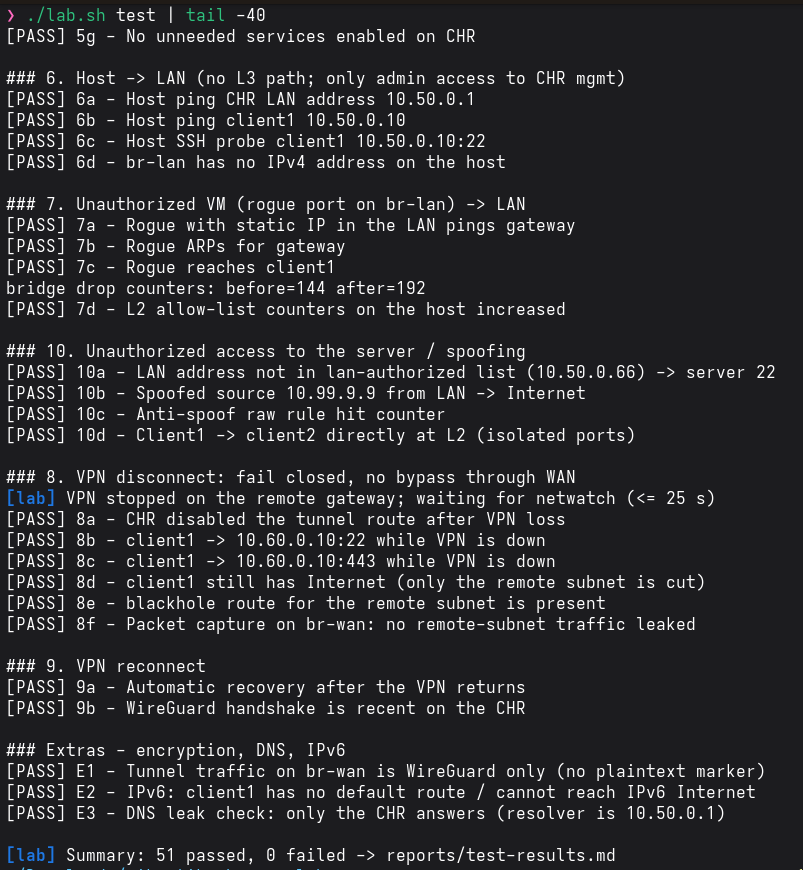
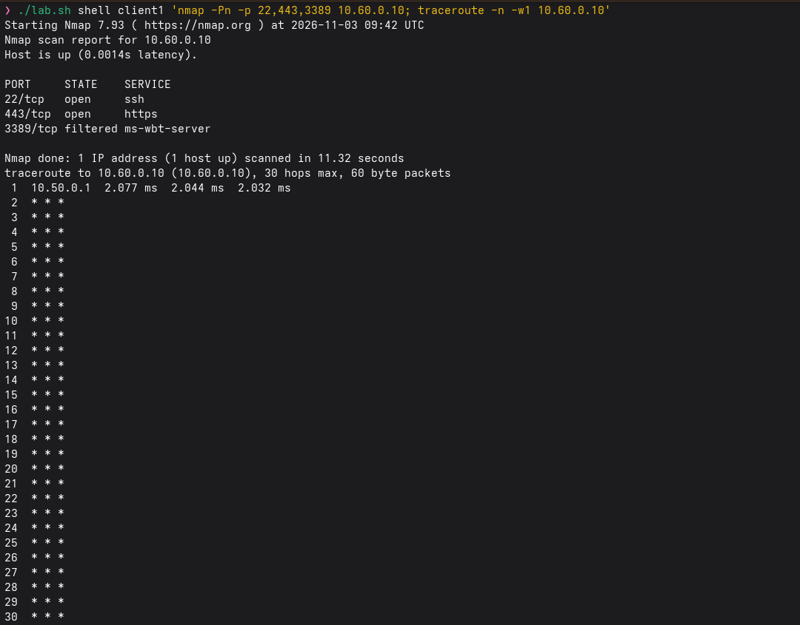
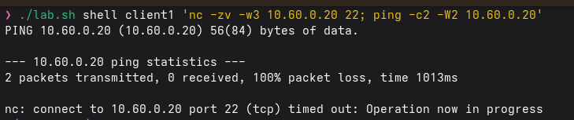
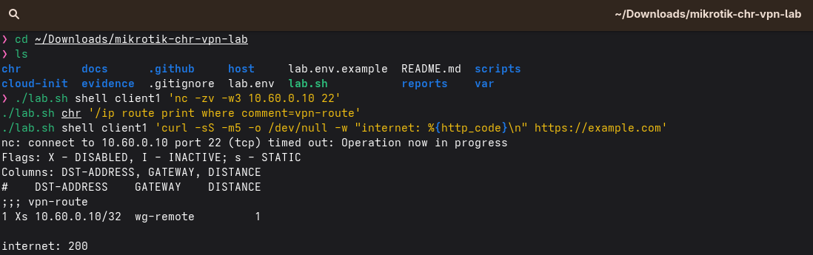
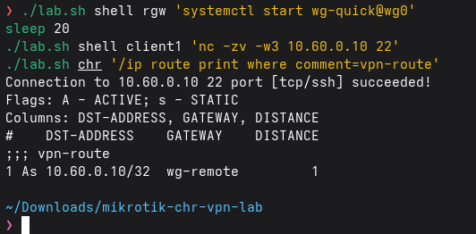
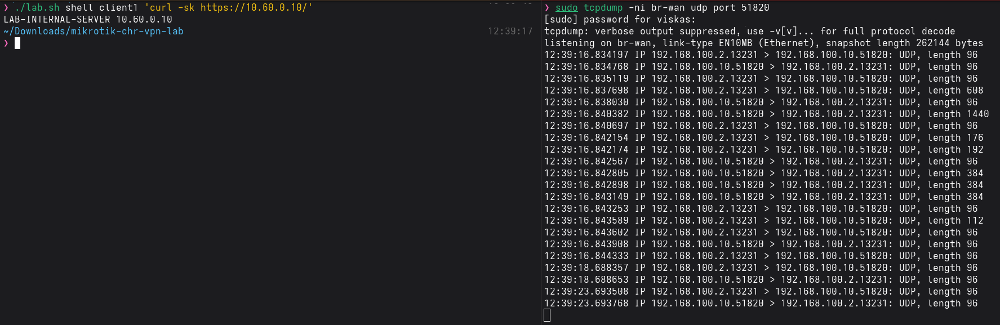

# Testing

`./lab.sh test` runs everything below and writes `reports/test-results.md` plus a sanitised log in `evidence/sanitized-logs/`.

| # | Check | Expected | How |
|---|---|---|---|
| 1 | LAN to Internet | web/NTP/ping allowed; SMTP and direct DNS blocked | curl, nc, dig from client1 |
| 2 | LAN to server | 22, 443, ping allowed | nc, curl, ping, traceroute |
| 3 | LAN to other remote IPs/ports | denied | 3389, 10.60.0.20, 10.60.0.1; nmap shows 22/443 open, 3389 filtered |
| 4 | WAN to LAN | denied | netns on `br-wan` with routes via CHR and via host |
| 5 | WAN to CHR management | denied | nmap of WAN address; foreign host on `br-mgmt` |
| 6 | Host to LAN | denied except admin to CHR mgmt | ping/nc from host; admin SSH works |
| 7 | Unauthorized VM to LAN | denied | rogue veth port with spoofed LAN IP on `br-lan`; L2 drop counters |
| 8 | VPN disconnect | no bypass route | stop WireGuard on the remote gateway; tcpdump on `br-wan` must show 0 packets to `10.60.0.0/24` |
| 9 | VPN reconnect | automatic recovery | start WireGuard again; server reachable within 120 s |
| 10 | Unauthorized server access | denied | unlisted LAN address, spoofed source, WAN host |
| E | Extras | | WireGuard-only on the wire, DNS resolver is the CHR, no IPv6 default route |

Test results of your own run are in [reports/test-results.md](../reports/test-results.md).

## Screenshots from my run

| Check | Screenshot |
|---|---|
| 2: LAN to server (ports 22 and 443 open, 3389 filtered) |  |
| 3: other remote hosts denied |  |
| 8: VPN down, no bypass |  |
| 9: automatic recovery |  |
| E: WireGuard only on the wire |  |

Same run step by step: [my-run.md](my-run.md).

## Commands worth screenshotting

Put PNG files into `evidence/screenshots/` named `NN-description.png`, then run `scripts/make-gallery.sh`.

| File name | Command |
|---|---|
| `01-qemu-vms-running.png` | `./lab.sh status` |
| `02-host-bridges.png` | `ip -br link show type bridge; ip -br addr; sudo nft list table bridge labl2` |
| `03-chr-interfaces-addresses.png` | `./lab.sh chr '/interface print; /ip address print'` |
| `04-wireguard-handshake.png` | `./lab.sh chr '/interface wireguard peers print detail'` |
| `05-routing-table.png` | `./lab.sh chr '/ip route print'` |
| `06-firewall-rules.png` | `./lab.sh chr '/ip firewall filter print stats'` |
| `07-client-to-server-ok.png` | `./lab.sh shell client1 'nmap -Pn -p 22,443,3389 10.60.0.10; traceroute -n 10.60.0.10'` |
| `08-denied-other-hosts.png` | `./lab.sh shell client1 'nc -zv -w3 10.60.0.20 22; ping -c2 10.60.0.20'` |
| `09-vpn-down-fail-closed.png` | `./lab.sh shell rgw 'systemctl stop wg-quick@wg0'`, then the same client commands, then the CHR route print |
| `10-vpn-reconnect.png` | `./lab.sh shell rgw 'systemctl start wg-quick@wg0'` |
| `11-tcpdump-wireguard-only.png` | `sudo tcpdump -ni br-wan udp port 51820` while client1 uses the server |
| `12-test-results.png` | `./lab.sh test` summary |
| `13-firewall-log.png` | `./lab.sh chr '/log print where message~"DENY"'` |

Mask passwords, IPs you do not want public and keys before publishing; keys never appear in the commands above, but check.

## First import on a new RouterOS version

`chr/chr-lab.rsc.tpl` targets RouterOS 7.x. If `/import` stops with an error on a newer release (typical suspects: `/tool netwatch` property names, `blackhole` route syntax), the output shows the failing line; fix it in the template and run `./lab.sh render && ./lab.sh reset-chr`.
